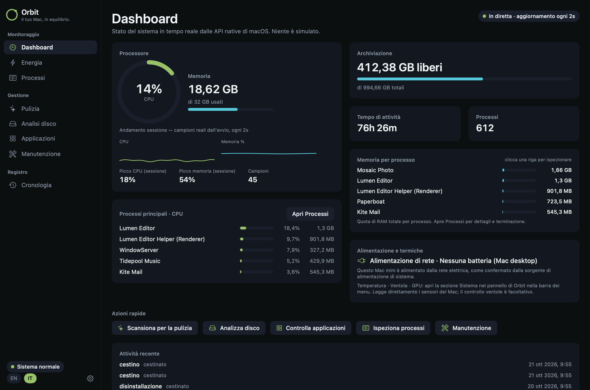
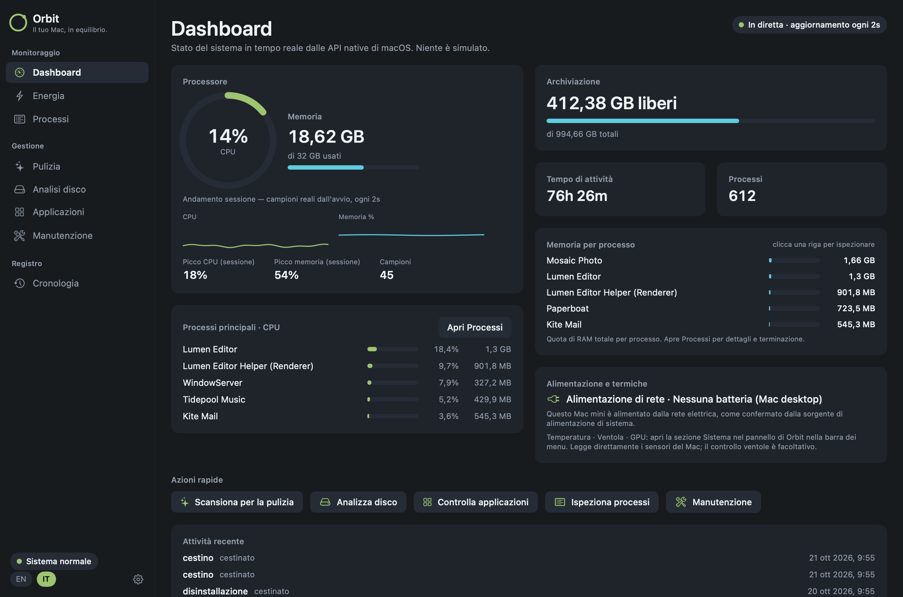
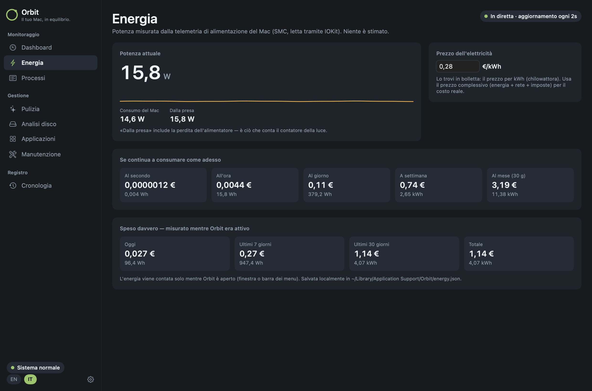
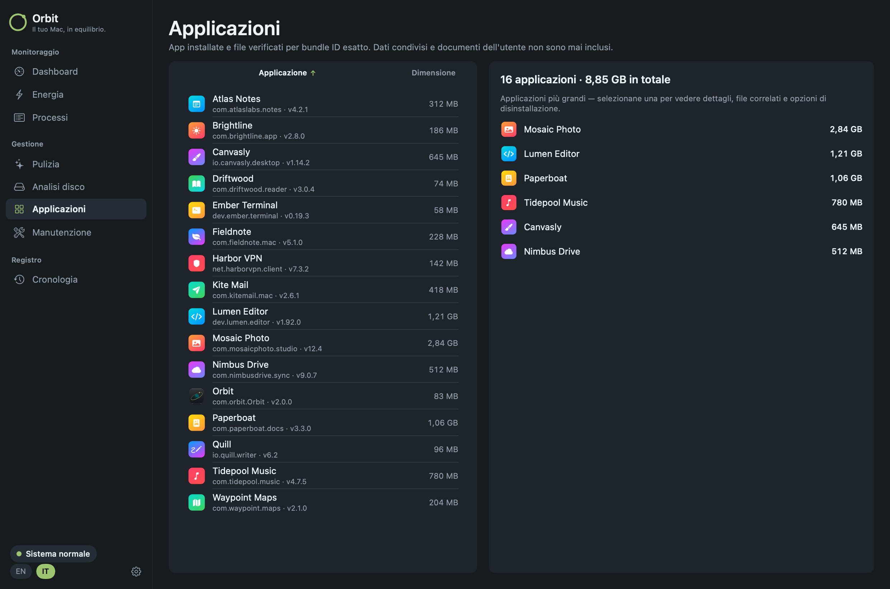
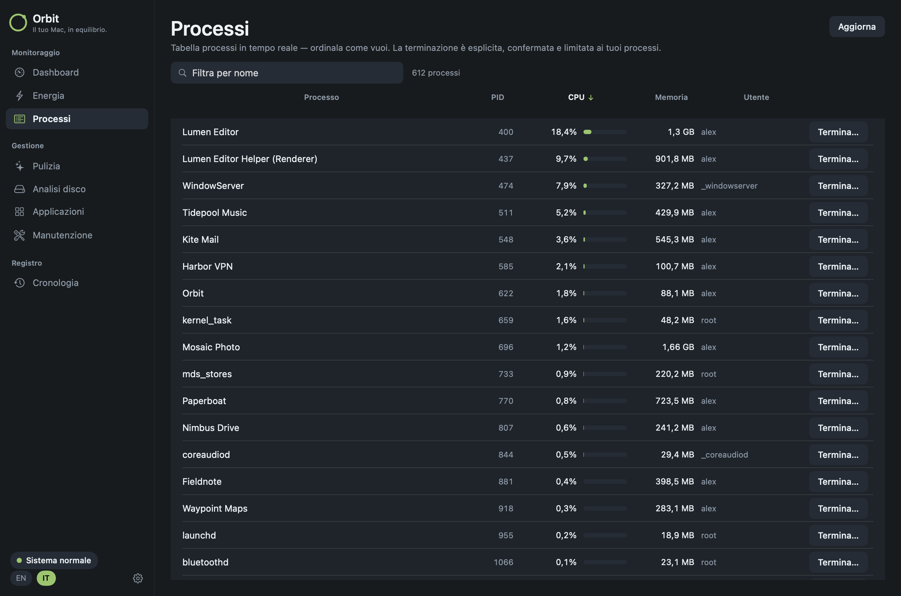
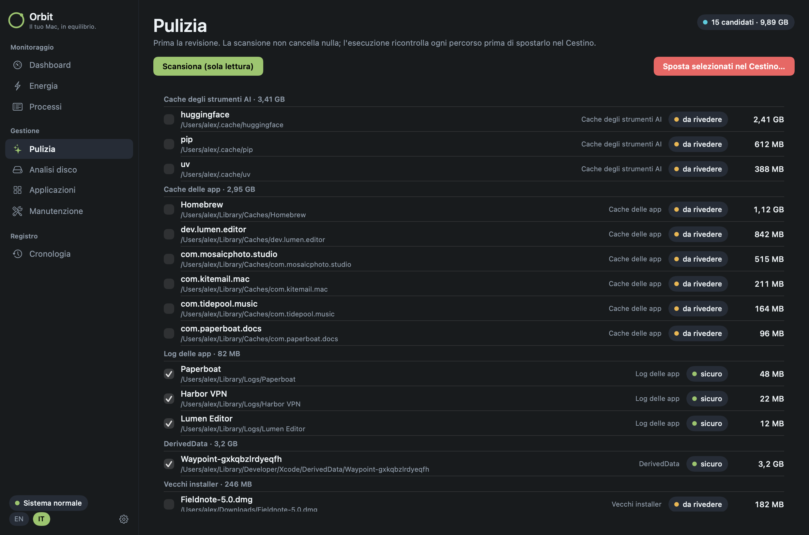
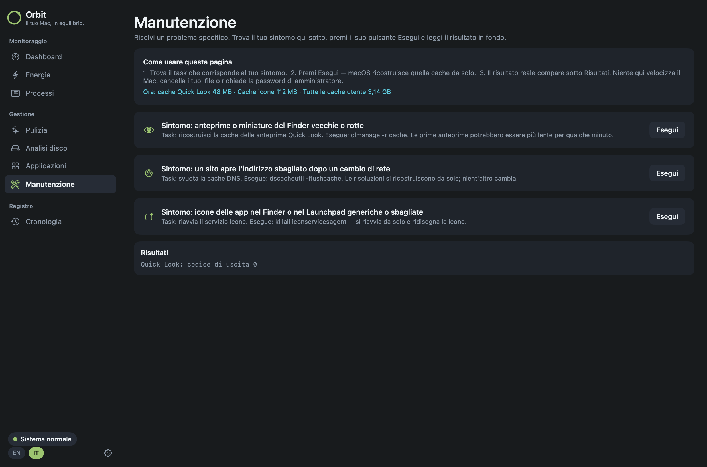

<div align="center">


# Orbit

**Il tuo Mac, in equilibrio.**

Monitora, pulisci e controlla il tuo Mac — da un'icona nella barra dei menu e da una finestra di manutenzione.

[English](README.md) · **Italiano**

[](#installazione)
[](https://github.com/Sero3105/Orbit/releases/latest)
[](LICENSE)

[**⬇︎ Scarica Orbit 2.0**](https://github.com/Sero3105/Orbit/releases/latest) · [Novità](#novità-della-20) · [Funzioni](#strumenti-nella-barra-dei-menu) · [Installazione](#installazione) · [Compilazione](#compilare-dal-sorgente)



<sub>Gli screenshot usano la modalità demo integrata di Orbit (<code>--demo</code>) con dati inventati — nessun utente, app o file reale.</sub>

</div>

---

## Novità della 2.0

- **Un'app, due parti.** Orbit ora vive nella barra dei menu con decine di strumenti — monitor di sistema con temperature e GPU, avvisi, rete, mantieni sveglio, gestione finestre, cronologia appunti, cattura schermo, mixer del volume e molto altro — e tiene la finestra di manutenzione a un clic di distanza.
- **Installa solo ciò che usi.** Ogni strumento si attiva o disattiva da Impostazioni → Funzioni; quelli che non usi non vengono caricati.
- **15 lingue**, tra cui italiano e inglese.
- **Un nuovo installer** e un'icona dell'app allineata alla griglia di macOS.
- **Licenza:** Orbit 2.0 è GPL-3.0-or-later perché include codice di [Vorssaint](#licenza-e-crediti).

## Perché Orbit

- 🔍 **Solo dati reali.** I numeri arrivano da macOS stesso. Se qualcosa non si può misurare, Orbit lo dice invece di inventarlo.
- 🗑️ **Prima controlli, poi Cestino.** Le scansioni non toccano mai un file. Ciò che rimuovi finisce nel Cestino — recuperabile — dopo la tua conferma.
- 🔒 **Privacy by design.** Nessun account, nessuna analitica, nessun tracciamento e nessun server Orbit. Ogni connessione di rete è elencata in [docs/PRIVACY.md](docs/PRIVACY.md).
- 🪶 **Nativa.** AppKit e SwiftUI, nessuna dipendenza esterna.

## Finestra di manutenzione

Si apre con **Manutenzione** in fondo al pannello nella barra dei menu.

<table>
<tr>
<td width="50%"></td>
<td width="50%"></td>
</tr>
<tr>
<td><b>Dashboard</b> — CPU, memoria, archiviazione, tempo di attività, numero di processi, processi principali per CPU e RAM, alimentazione, in tempo reale. Si aggiorna ogni 2 secondi.</td>
<td><b>Energia</b> — consumo in watt dalla telemetria del Mac, il tuo prezzo al kWh, e quanto costa il Mac al secondo, all'ora, al giorno, alla settimana e al mese — più quanto ha <i>davvero</i> speso oggi, questa settimana e questo mese.</td>
</tr>
<tr>
<td></td>
<td></td>
</tr>
<tr>
<td><b>Applicazioni</b> — ogni app installata con versione, dimensione e bundle ID. La disinstallazione rimuove l'app <i>e ogni file residuo che Orbit può dimostrare essere suo</i>, trovato per bundle ID esatto — mai per nome.</td>
<td><b>Processi</b> — tabella dei processi in tempo reale e ordinabile. Puoi terminare i tuoi processi dopo una conferma.</td>
</tr>
<tr>
<td></td>
<td></td>
</tr>
<tr>
<td><b>Pulizia</b> — scansione in sola lettura di cache delle app, log vecchi, installer vecchi in Download, DerivedData di Xcode e cache di strumenti di sviluppo e AI. Gli elementi sicuri sono preselezionati, il resto lo scegli tu.</td>
<td><b>Manutenzione</b> — risolvi problemi specifici partendo dal sintomo: ricostruisci le anteprime Quick Look, svuota la cache DNS, aggiorna le icone delle app. Ogni operazione mostra cosa esegue e il risultato reale.</td>
</tr>
<tr>
<td colspan="2"><b>Analisi disco</b> — misura le cartelle, entra nelle sottocartelle, mostra nel Finder, sposta nel Cestino le cartelle di terze parti (anche dentro <code>~/Library</code>). &nbsp;·&nbsp; <b>Cronologia</b> — un registro locale di ogni modifica fatta da Orbit.</td>
</tr>
</table>

<details>
<summary><b>Come funzionano i numeri dell'energia</b></summary>

I Mac con Apple Silicon — portatili **e** desktop come il Mac mini — pubblicano la telemetria di alimentazione dell'SMC tramite IOKit. Orbit la legge ogni 2 secondi (API pubblica, senza root):

| Valore | Significato |
| --- | --- |
| **Consumo del Mac** | La potenza che il Mac sta usando |
| **Dalla presa** | Consumo + perdita dell'alimentatore — ciò che conta il contatore della luce |
| **Proiezioni di costo** | Potenza dalla presa × il tuo €/kWh, al secondo, all'ora, al giorno, alla settimana, al mese |
| **Speso davvero** | Energia sommata campione per campione mentre Orbit è aperto, salvata per giorno in `~/Library/Application Support/Orbit/energy.json` |

Inserisci il **prezzo al kWh tutto compreso** della bolletta (energia + rete + imposte) per avere il costo reale.

</details>

## Strumenti nella barra dei menu

Fai clic su una categoria per vederne gli strumenti.

<details>
<summary><b>🔊 Audio</b></summary>

- **Mixer del volume.** Volume per singola app, amplificazione oltre il 100% per l'audio troppo basso, preferiti fissati e riordinabili. Nessun driver audio necessario.
- **Uscita per app.** La musica dagli altoparlanti mentre la chiamata usa le cuffie.
- **Cambio uscita.** Cambia uscita audio con una scorciatoia e abbassa il volume quando scolleghi le cuffie.
- **Strumenti microfono.** Scegli l'ingresso preferito, regolane il livello sui dispositivi supportati e silenzia tutti i microfoni con una scorciatoia.
- **Blocco app Musica.** Evita che Musica si apra da sola dopo la pressione dei tasti di riproduzione. Richiede Accessibilità.

</details>

<details open>
<summary><b>📈 Cosa sta facendo il tuo Mac</b></summary>

- **Monitor di sistema.** CPU, GPU, memoria, temperature, salute della batteria e consumi, con grafici storici e l'elenco delle app che consumano più energia.
- **Controllo ventole (beta).** Imposta velocità manuali o curve di temperatura e guarda gli RPM in tempo reale.
- **Valori nella barra dei menu.** Metti direttamente nella barra dei menu le letture che vuoi, barre di utilizzo, autonomia della batteria o velocità delle ventole.
- **Rete.** Traffico in tempo reale, totali della sessione e indirizzo IP locale, oppure un test di velocità.
- **Avvisi.** Notifiche per CPU alta prolungata, temperature elevate, pressione sulla memoria, disco quasi pieno o batteria scarica.

</details>

<details>
<summary><b>🪟 Finestre e Dock</b></summary>

- **Cambio app.** Passa tra app e finestre con anteprime dal vivo, ricerca e filtri per schermo. Una modalità semplice funziona senza registrazione dello schermo.
- **Disposizione finestre.** Aggancia le finestre a layout, spostale tra monitor e ripristina le posizioni precedenti con scorciatoie, bordi dello schermo o trascinamento con modificatore.
- **Anteprima Dock.** Passa sulle icone del Dock per vedere le finestre su tutte le scrivanie. Cambia, chiudi, sposta o aggancia direttamente dall'anteprima.
- **Clic sul Dock.** Clic sull'icona di un'app attiva per ridurla, nasconderla o scorrere tra le sue finestre.
- **Massimizza finestre.** Il pulsante verde riempie lo schermo senza creare un'altra Scrivania.
- **Ordine fisso delle Scrivanie.** Le Scrivanie restano nell'ordine che hai scelto invece di riordinarsi in base all'uso. Disattivandolo torna l'impostazione precedente.
- **Esci alla chiusura.** Chiudi le app scelte quando si chiude la loro ultima finestra.
- **Protezione uscita e chiusura.** Evita ⌘Q o ⌘W accidentali con pressione prolungata, doppia pressione o un modificatore in più, per singola app.

</details>

<details>
<summary><b>⌨️ Tastiera e mouse</b></summary>

- **Frammenti di testo.** Espandi abbreviazioni in testo, con variabili per appunti, data e ora, o inserisci frammenti da un menu con ricerca.
- **Scorrimento fluido.** Una rotella del mouse più morbida, con velocità e risposta regolabili.
- **Accelerazione del puntatore.** Disattiva l'accelerazione del mouse e ripristina l'impostazione precedente quando lo spegni.
- **Scorrimento lineare.** Ogni scatto della rotella scorre lo stesso numero di righe, a qualunque velocità.
- **Il focus segue il mouse.** Porta in primo piano la finestra sotto il puntatore dopo una pausa regolabile.
- **Direzione di scorrimento.** Inverti lo scorrimento verticale e orizzontale del mouse indipendentemente dal trackpad.
- **Scorrimento laterale con un tasto.** Trasforma la rotella verticale in scorrimento orizzontale tenendo premuto un tasto.
- **Tasti laterali.** Usa i tasti Indietro e Avanti del mouse in Finder, browser e app compatibili.
- **Scorciatoie per i tasti del mouse.** Assegna tasti ai pulsanti extra e alle rotelle laterali, o usa gesti di trascinamento per Scrivanie e Mission Control.
- **Clic centrale.** Una pressione a tre dita sul trackpad diventa un clic centrale.
- **App da lasciare stare.** Escludi le app che vuoi dai miglioramenti del mouse.
- **Filtro clic doppi.** Ignora i clic ripetuti involontari dei tasti consumati senza rallentare i clic normali.
- **Antirimbalzo tasti.** Filtra le lettere ripetute causate da una tastiera usurata.
- **Super tasto.** Usa Bloc Maiusc o un modificatore destro come combinazione per le scorciatoie, con un'azione separata per la singola pressione ed esclusioni per app.
- **Scorciatoie da tastiera.** Gestisci in un solo posto le scorciatoie di tutte le funzioni, incluso il controllo facoltativo di quelle di macOS supportate.

</details>

<details>
<summary><b>📋 Appunti, file e link</b></summary>

- **Cronologia appunti.** Cerca testi, immagini e file copiati in locale, fissa i preferiti, guarda l'anteprima e incolla con le scorciatoie.
- **Svuota appunti automaticamente.** Svuota gli appunti di sistema dopo un intervallo, lo stop o il blocco, mantenendo la cronologia salvata.
- **Incolla come testo semplice.** Incolla senza formattazione mantenendo il contenuto originale negli appunti.
- **Scaffale.** Parcheggia file, testi e link vicino al cursore mentre trascini, poi rilasciali o condividili dopo.
- **Scorciatoie Finder.** Sposta file con ⌘X e ⌘V, rinomina con F2 o incolla le immagini copiate come file PNG.
- **Pulisci URL.** Rimuovi i parametri di tracciamento dai link, a mano o in automatico.
- **Installer da immagine disco.** Installa un'app da un'immagine disco montata ed espellila, eliminando facoltativamente il file scaricato.

</details>

<details>
<summary><b>🧰 Strumenti di tutti i giorni</b></summary>

- **Dynamic Island.** Musica, notifiche, calendari, timer, download e controlli quotidiani attorno alla fotocamera, o in una simulata sugli altri Mac. Sezioni e scorciatoie personalizzabili, con testi delle canzoni, equalizzatore, anteprima fotocamera e strumenti per i file facoltativi.
- **Agenti AI.** Segui Claude, Codex, OpenCode e GitHub Copilot nella Dynamic Island: limiti del piano e quando si azzerano dove disponibile, token, valore API, modelli, progetti e lavoro in corso, con un avviso quando un'attività lunga finisce.
- **Barra comandi.** Cerca app, finestre, file, cronologia appunti, frammenti e comandi dei menu delle app da un unico campo. Calcola, converti unità, trova emoji o esegui script salvati.
- **Pannello rapido.** Una palette mobile con i tuoi strumenti preferiti, con ⌃⌘V.
- **Interruttori rapidi.** Cambia aspetto, nascondi le icone della scrivania, espelli i dischi, svuota il Cestino, blocca lo schermo e altro.
- **Menu radiale.** Una ruota personalizzabile di app, file, scorciatoie e strumenti attorno al puntatore, con profili e sottomenu.
- **Blocco note.** Note salvate automaticamente in schede, con anteprima ed esportazione Markdown, in una finestra mobile o nella Dynamic Island.
- **Modalità pulizia.** Blocca la tastiera mentre la pulisci, con schermo nero o un piccolo indicatore visibile.

</details>

<details>
<summary><b>📸 Cattura e crea</b></summary>

- **Cattura schermo.** Passa tra screenshot, registrazione, riconoscimento testo e selettore colore in un unico pannello con lente d'ingrandimento.
- **Screenshot.** Cattura un'area, una finestra, lo schermo o una pagina a scorrimento. Annota, ritaglia, oscura, aggiungi sfondi e filigrane, fissa le catture o inviale dal menu Condividi.
- **Registrazione schermo.** Registra con tracce separate per l'audio di sistema e il microfono. Taglia, aggiungi zoom automatici, sfoca i dettagli privati ed esporta video o GIF.
- **Anteprima fotocamera.** Controlla la fotocamera in uno specchio mobile o nella Dynamic Island prima di una chiamata.
- **Copia testo dallo schermo.** Riconosci il testo offline da qualsiasi area dello schermo o leggi un codice QR.
- **Selettore colore.** Copia un colore dallo schermo come HEX, RGB, HSL o codice SwiftUI.
- **Strumenti multimediali.** Comprimi e modifica video, converti immagini in blocco, aggiungi filigrane, crea GIF ed estrai testo, tutto in locale.

</details>

<details>
<summary><b>📦 Gestione app</b></summary>

- **Aggiornamenti app.** Controlla in un'unica lista le app dello store, quelle gestite da package manager e i feed degli sviluppatori supportati. Installa insieme gli aggiornamenti gestiti o apri l'updater dell'app.
- **Pulizia.** Rimuovi cache, log e residui delle app, a mano o con una pianificazione.
- **Download delle app di messaggistica.** Controlla, organizza o sposta nel Cestino i download delle app di messaggistica con regole di conservazione.
- **Disinstallazione.** Rimuovi le app controllando prima cache, preferenze e helper collegati, poi spostali nel Cestino.
- **Gestione Homebrew.** Cerca, installa e rimuovi formule e cask senza aprire il Terminale.
- **Gestione porte.** Trova i processi in ascolto sulle porte di rete e fermali con Termina processo, se installato.

</details>

<details>
<summary><b>🔋 Energia e schermo</b></summary>

- **Mantieni sveglio.** Tieni il Mac attivo con un timer, a coperchio chiuso, o finché ci sono app scelte, alimentazione o monitor esterni collegati.
- **Schermi.** Controlla i singoli monitor e la loro luminosità, con controllo hardware dove supportato, passi da metà o un quarto per i tasti della luminosità, attenuazione extra sotto il minimo del monitor e attenuazione software come alternativa.
- **Luminosità extra.** Usa il margine HDR del display XDR del MacBook Pro per superare la luminosità massima normale.
- **Bluetooth in stop.** Scollega il Bluetooth durante lo stop e riattivalo al risveglio solo se l'ha spento Orbit.

</details>

## Installazione


1. Scarica **`Orbit-2.0.0.dmg`** dalle [Release](https://github.com/Sero3105/Orbit/releases/latest).
2. Aprilo e trascina **Orbit** nella cartella **Applicazioni**.
3. Primo avvio: Orbit non è ancora notarizzata da Apple, quindi macOS la blocca una volta. Apri **Impostazioni di Sistema → Privacy e sicurezza**, scorri in basso e fai clic su **Apri comunque**.
   <br><sub>In alternativa dal Terminale: `xattr -dr com.apple.quarantine /Applications/Orbit.app`</sub>

Richiede **macOS 14 Sonoma o successivo**. Il controllo ventole e l'installazione degli aggiornamenti dall'app richiedono release firmate con un Apple Developer ID; fino ad allora **Installa aggiornamento** apre la pagina della release.

## Privacy e sicurezza

- Nessun account, analitica o tracciamento, e nessun server Orbit: i link di condivisione temporanei sono disattivati e il feedback apre le issue su GitHub.
- Ogni connessione che l'app può fare, e cosa invia, è in [docs/PRIVACY.md](docs/PRIVACY.md). I permessi sono spiegati in [docs/PERMISSIONS.md](docs/PERMISSIONS.md).
- La finestra di manutenzione mantiene le sue garanzie: scansioni in sola lettura, rimozione solo nel Cestino dopo conferma e nuova verifica, niente `sudo`, niente rete. Vedi [docs/security-model.md](docs/security-model.md).
- Segnalazioni di sicurezza: [SECURITY.md](SECURITY.md).

## Compilare dal sorgente

Bastano i Command Line Tools; Xcode è facoltativo.

```bash
git clone https://github.com/Sero3105/Orbit.git && cd Orbit
./build.sh                 # build release → build/stage/Orbit.app
./build.sh --dev --install # "Orbit (Developer)" accanto all'app release
./build.sh --test          # tutti i test
./Tools/make-dmg.sh        # dist/Orbit-<versione>.dmg (dopo ./build.sh)
```

<details>
<summary><b>Struttura del progetto</b></summary>

```
Sources/
  Orbit/             app nella barra dei menu (AppKit + SwiftUI)
  OrbitMaintenance/  finestra di manutenzione (SwiftUI)
  OrbitCore/         scansione, verifiche di sicurezza, metriche, telemetria energetica (senza UI)
  OrbitCheck/        test di OrbitCore
  FanControlHelper/  helper privilegiato facoltativo per le ventole
Tests/               test eseguiti da ./build.sh --test
Tools/               script per DMG, icone e firma
```

</details>

## Licenza e crediti

Orbit è distribuita con licenza [GNU General Public License v3.0 o successiva](LICENSE).

Orbit include codice di [Vorssaint](https://github.com/vorssaint/vorssaint-utils) © 2026 Vorssaint, con licenza GPL-3.0-or-later; la sua storia fa parte di questo repository e il suo changelog precedente è in [docs/upstream-vorssaint-CHANGELOG.md](docs/upstream-vorssaint-CHANGELOG.md). Orbit non è affiliata né approvata da Vorssaint e non ne usa nome, logo o icona (vedi [docs/upstream-vorssaint-TRADEMARKS.md](docs/upstream-vorssaint-TRADEMARKS.md)).

Le funzioni di manutenzione di Orbit sono ispirate a [Mole](https://github.com/tw93/Mole); sono un'implementazione indipendente e non contengono codice o asset di Mole.
