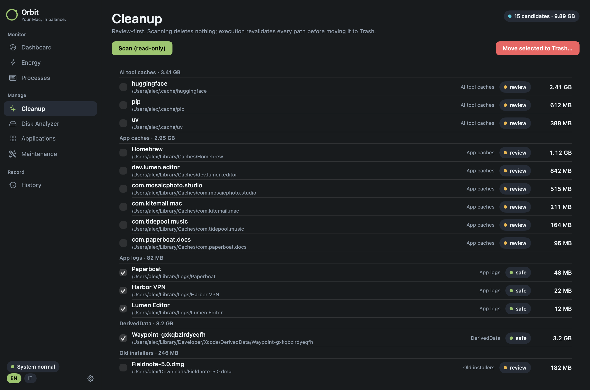
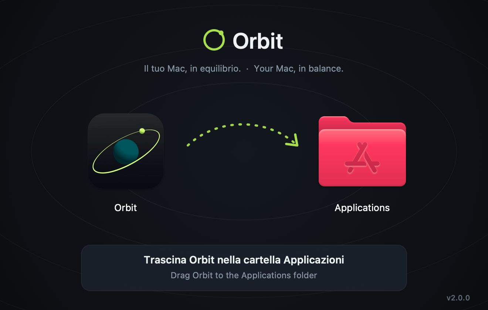

<div align="center">


# Orbit

**Your Mac, in balance.**

Monitor, clean up and control your Mac — from one menu bar icon and one maintenance window.

**English** · [Italiano](README.it.md)

[](#install)
[](https://github.com/Sero3105/Orbit/releases/latest)
[](LICENSE)

[**⬇︎ Download Orbit 2.0**](https://github.com/Sero3105/Orbit/releases/latest) · [What's new](#whats-new-in-20) · [Features](#menu-bar-tools) · [Install](#install) · [Build](#build-from-source)


<sub>Screenshots use Orbit's built-in demo mode (<code>--demo</code>) with fictional data — no real user, apps or files.</sub>

</div>

---

## What's new in 2.0

- **One app, two parts.** Orbit now lives in the menu bar with dozens of tools — system monitor with temperatures and GPU, alerts, network, keep awake, window management, clipboard history, screen capture, volume mixer and more — and keeps its maintenance window one click away.
- **Install only what you use.** Every tool can be switched on or off from Settings → Features; tools you don't use stop loading.
- **15 languages**, including English and Italian.
- **A new installer** and an app icon that sits on the macOS grid.
- **License:** Orbit 2.0 is GPL-3.0-or-later because it includes code from [Vorssaint](#license-and-credits).

## Why Orbit

- 🔍 **Real data only.** Numbers come from macOS itself. If something can't be measured, Orbit says so instead of guessing.
- 🗑️ **Review first, Trash always.** Scans never touch a file. Anything removed goes to the Trash — recoverable — after you confirm it.
- 🔒 **Private by design.** No account, no analytics, no tracking and no Orbit server. Every network connection is listed in [docs/PRIVACY.md](docs/PRIVACY.md).
- 🪶 **Native.** AppKit and SwiftUI, no third-party dependencies.

## Maintenance window

Open it with **Maintenance** at the bottom of the menu bar panel.

<table>
<tr>
<td width="50%"></td>
<td width="50%"></td>
</tr>
<tr>
<td><b>Dashboard</b> — live CPU, memory, storage, uptime, process count, top processes by CPU and RAM, power source. Refreshes every 2 seconds.</td>
<td><b>Energy</b> — real-time wattage from the Mac's own power telemetry, your price per kWh, and what your Mac costs per second, hour, day, week and month — plus what it <i>actually</i> spent today, this week and this month.</td>
</tr>
<tr>
<td></td>
<td></td>
</tr>
<tr>
<td><b>Applications</b> — every installed app with version, size and bundle ID. Uninstall removes the app <i>and every leftover Orbit can prove is its own</i>, matched by exact bundle ID — never by name.</td>
<td><b>Processes</b> — live, sortable process table. Terminate your own processes after confirmation.</td>
</tr>
<tr>
<td></td>
<td></td>
</tr>
<tr>
<td><b>Cleanup</b> — read-only scan of app caches, old logs, old installers in Downloads, Xcode DerivedData and developer/AI-tool caches. Safe items pre-selected, everything else opt-in.</td>
<td><b>Maintenance</b> — fix specific glitches by symptom: rebuild Quick Look previews, flush DNS, refresh app icons. Each task shows exactly what it runs and its real result.</td>
</tr>
<tr>
<td colspan="2"><b>Disk Analyzer</b> — measure folders, drill down, reveal in Finder, move third-party folders (even inside <code>~/Library</code>) to the Trash. &nbsp;·&nbsp; <b>History</b> — a local log of every change Orbit made.</td>
</tr>
</table>

<details>
<summary><b>How the energy numbers work</b></summary>

Apple Silicon Macs — laptops **and** desktops like the Mac mini — publish power telemetry from the SMC through IOKit. Orbit reads it every 2 seconds (public API, no root):

| Value | Meaning |
| --- | --- |
| **Mac consumption** | Power the Mac itself is using |
| **From the wall** | Consumption + power-adapter loss — what your electricity meter counts |
| **Cost projections** | Current wall power × your €/kWh, over a second, hour, day, week, month |
| **Actually spent** | Energy integrated sample by sample while Orbit runs, stored per day in `~/Library/Application Support/Orbit/energy.json` |

Enter the **all-in price per kWh** from your electricity bill (energy + network + taxes) for the real cost.

</details>

## Menu bar tools

Click a category to see its tools.

<details>
<summary><b>🔊 Sound</b></summary>

- **Volume mixer.** Set volume per app, boost quiet audio past 100%, and pin or reorder favorites. No audio driver required.
- **Per app output.** Play music through speakers while a call uses your headset.
- **Output switcher.** Switch audio outputs with a shortcut and lower the volume when headphones disconnect.
- **Microphone tools.** Choose a preferred input, adjust its level on supported devices, and mute all microphones with one shortcut.
- **Music app blocker.** Prevent unwanted Music launches after detected playback-button presses. Requires Accessibility.

</details>

<details open>
<summary><b>📈 Know what your Mac is doing</b></summary>

- **System monitor.** CPU, GPU, memory, temperatures, battery health and power use, with history graphs and a view of energy-hungry apps.
- **Fan Control (beta).** Set manual fan speeds or temperature curves and monitor live RPM.
- **Menu bar readouts.** Put your chosen readings, usage bars, battery time or fan speed directly in the menu bar.
- **Network.** See live traffic, session totals and your local IP address, or run a speed test.
- **Alerts.** Get notified about sustained CPU load, high temperatures, memory pressure, low disk space or low battery.

</details>

<details>
<summary><b>🪟 Windows and the Dock</b></summary>

- **App switcher.** Switch between apps and windows with live previews, search and display filters. A simpler mode works without screen capture.
- **Window layout.** Snap windows into layouts, move them between displays and restore earlier positions using shortcuts, screen edges or modifier-drag gestures.
- **Dock Preview.** Hover over Dock icons to preview windows across desktops. Switch, close, move or snap them from the preview.
- **Dock clicks.** Click an active app's Dock icon to minimize, hide or cycle through its windows.
- **Maximize windows.** Use the green button to fill the screen without creating another Space.
- **Fixed Space order.** Keep Spaces in the order you set instead of rearranging them by recent use. Turning it off restores your previous setting.
- **Quit on close.** Quit selected apps when their last window closes.
- **Quit and close protection.** Prevent accidental ⌘Q or ⌘W with a hold, double press or extra modifier, per app.

</details>

<details>
<summary><b>⌨️ Keyboard and mouse</b></summary>

- **Text snippets.** Expand short triggers into text with clipboard, date and time variables, or insert snippets from a searchable menu.
- **Smooth scrolling.** Give your mouse wheel a fluid glide with adjustable speed and response.
- **Pointer acceleration.** Disable mouse acceleration and restore your previous setting when turned off.
- **Linear scrolling.** Make every mouse wheel notch scroll the same number of lines, however fast the wheel spins.
- **Focus follows mouse.** Bring the window under the pointer forward after an adjustable pause.
- **Scroll direction.** Invert vertical and horizontal mouse scrolling independently of the trackpad.
- **Scroll sideways while holding a key.** Turn vertical wheel movement into horizontal scrolling while holding a chosen key.
- **Side buttons.** Use mouse Back and Forward buttons in Finder, browsers and compatible apps.
- **Mouse button shortcuts.** Assign keys to extra buttons and side wheels, or use button-drag gestures for Spaces and Mission Control.
- **Middle click.** Turn a three-finger trackpad press into a middle click.
- **Apps to leave alone.** Exclude chosen apps from mouse enhancements.
- **Extra click filter.** Ignore accidental rapid clicks from worn mouse buttons without delaying normal clicks.
- **Key debounce.** Filter repeated letters caused by a worn keyboard.
- **Super key.** Use Caps Lock or a right-side modifier as a shortcut combination, with a separate tap action and app exclusions.
- **Keyboard shortcuts.** Manage feature shortcuts in one place, including optional takeover of supported macOS shortcuts while a feature is active.

</details>

<details>
<summary><b>📋 Clipboard, files and links</b></summary>

- **Clipboard history.** Search local text, image and file history, pin favorites, preview entries and paste with shortcuts.
- **Auto clear clipboard.** Clear the system clipboard after a delay, sleep or lock, while keeping saved history.
- **Paste as plain text.** Paste without formatting while preserving the original clipboard content.
- **Shelf.** Park files, text and links near your cursor while dragging, then drop or share them later.
- **Finder shortcuts.** Move files with ⌘X and ⌘V, rename with F2, or paste copied images as PNG files.
- **Clean URL.** Remove tracking parameters from links, manually or automatically.
- **Disk image installer.** Install an app from a mounted disk image and eject it, with optional download cleanup.

</details>

<details>
<summary><b>🧰 Everyday tools</b></summary>

- **Dynamic Island.** Keep music, notifications, calendars, timers, downloads and everyday controls around the camera cutout, or a simulated one on other Macs. Customize sections and shortcuts, with optional lyrics, a live equalizer, camera preview and file tools.
- **AI agents.** Follow Claude, Codex, OpenCode and GitHub Copilot in the Dynamic Island: plan limits and when they reset where available, tokens, API value, models, projects and live work, with a notice when a long task finishes. Codex's banked resets can be used from there too, and each extra Codex account (`CODEX_HOME`) can have a limits card of its own. Copilot uses local CLI/app session logs; its token totals update when shutdown metrics arrive, and aggregate API-value estimates use base rates.
- **Command Bar.** Search apps, windows, files, clipboard history, snippets and app menu commands from one field. Calculate, convert units, find emoji or run saved scripts.
- **Quick panel.** Open a floating palette of favorite tools with ⌃⌘V.
- **Quick toggles.** Switch appearance, hide desktop icons, eject disks, empty the Trash, lock the screen and more.
- **Radial menu.** Open a customizable wheel of apps, files, shortcuts and tools around the pointer, with profiles and submenus.
- **Scratchpad.** Keep autosaved notes in tabs, with Markdown preview and export, in a floating window or Dynamic Island.
- **Cleaning Mode.** Lock keyboard input while cleaning, with a black screen or a small visible indicator.

</details>

<details>
<summary><b>📸 Capture and create</b></summary>

- **Screen capture.** Switch between screenshots, recording, text recognition and color picking in one selector with a pixel magnifier.
- **Screenshot.** Capture an area, window, screen or scrolling page. Annotate, crop, redact, add backgrounds and watermarks, pin captures or send them through the Share menu.
- **Screen recording.** Record with separate system-audio and microphone tracks. Trim, cut, add automatic zooms, blur private details and export video or GIFs.
- **Camera preview.** Check your camera in a floating mirror or Dynamic Island before a call.
- **Copy text from screen.** Recognize text offline from any screen area, or read a QR code.
- **Color picker.** Copy a screen color as HEX, RGB, HSL or SwiftUI code.
- **Media tools.** Compress and edit videos, batch-convert images, add watermarks, make GIFs and extract text, all locally.

</details>

<details>
<summary><b>📦 App management</b></summary>

- **App updates.** Check store apps, package-managed apps and supported developer feeds in one list. Install managed updates together or open an app's own updater.
- **Cleaner.** Remove caches, logs and app leftovers, manually or on a schedule.
- **Messaging downloads.** Review, organize or move messaging downloads to the Trash using retention rules.
- **Uninstaller.** Remove apps and review their related caches, preferences and helpers before moving them to the Trash.
- **Homebrew manager.** Search, install and remove formulae and casks without opening a terminal.
- **Port manager.** Find processes listening on network ports and stop them with Kill Process when installed.

</details>

<details>
<summary><b>🔋 Energy and display</b></summary>

- **Keep awake.** Keep your Mac working on a timer, with the lid closed, or while selected apps, power or external displays are present.
- **Displays.** Control individual displays and brightness, with hardware control where supported, half or quarter steps for the brightness keys, optional extra dimming below a monitor's minimum, and software dimming as a fallback.
- **Extra brightness.** Use a MacBook Pro XDR display's HDR headroom to go beyond its normal maximum brightness.
- **Bluetooth on sleep.** Disconnect Bluetooth during sleep and restore it on wake only if Orbit turned it off.

</details>

## Install



1. Download **`Orbit-2.0.0.dmg`** from [Releases](https://github.com/Sero3105/Orbit/releases/latest).
2. Open it and drag **Orbit** onto **Applications**.
3. First launch: Orbit is not notarized by Apple yet, so macOS blocks it once. Open **System Settings → Privacy & Security**, scroll down and click **Open Anyway**.
   <br><sub>Terminal alternative: `xattr -dr com.apple.quarantine /Applications/Orbit.app`</sub>

Requires **macOS 14 Sonoma or later**. Fan Control and installing updates from inside the app need releases signed with an Apple Developer ID; until then, **Install update** opens the release page.

## Privacy and safety

- No account, analytics or tracking, and no Orbit server: temporary share links are off and feedback opens GitHub issues.
- Every connection the app can make, and what it sends, is in [docs/PRIVACY.md](docs/PRIVACY.md). Permissions are explained in [docs/PERMISSIONS.md](docs/PERMISSIONS.md).
- The maintenance window keeps its guarantees: read-only scans, Trash-only removal after confirmation and revalidation, no `sudo`, no network. See [docs/security-model.md](docs/security-model.md).
- Security reports: [SECURITY.md](SECURITY.md).

## Build from source

Command Line Tools are enough; Xcode is optional.

```bash
git clone https://github.com/Sero3105/Orbit.git && cd Orbit
./build.sh                 # release build → build/stage/Orbit.app
./build.sh --dev --install # "Orbit (Developer)" next to the release app
./build.sh --test          # full test suite
./Tools/make-dmg.sh        # dist/Orbit-<version>.dmg (after ./build.sh)
```

<details>
<summary><b>Project layout</b></summary>

```
Sources/
  Orbit/             menu bar app (AppKit + SwiftUI)
  OrbitMaintenance/  maintenance window (SwiftUI)
  OrbitCore/         scanning, safety validation, metrics, power telemetry (no UI)
  OrbitCheck/        check suite for OrbitCore
  FanControlHelper/  optional privileged fan-control helper
Tests/               test suite run by ./build.sh --test
Tools/               DMG, icon and signing scripts
```

</details>

## License and credits

Orbit is licensed under the [GNU General Public License v3.0 or later](LICENSE).

Orbit includes code from [Vorssaint](https://github.com/vorssaint/vorssaint-utils) © 2026 Vorssaint, licensed under GPL-3.0-or-later; its history is part of this repository and its earlier changelog is in [docs/upstream-vorssaint-CHANGELOG.md](docs/upstream-vorssaint-CHANGELOG.md). Orbit is not affiliated with or endorsed by Vorssaint and uses none of its name, logo or icon (see [docs/upstream-vorssaint-TRADEMARKS.md](docs/upstream-vorssaint-TRADEMARKS.md)).

Orbit's maintenance feature set was inspired by [Mole](https://github.com/tw93/Mole); it is an independent clean-room implementation and contains no Mole code or assets.
