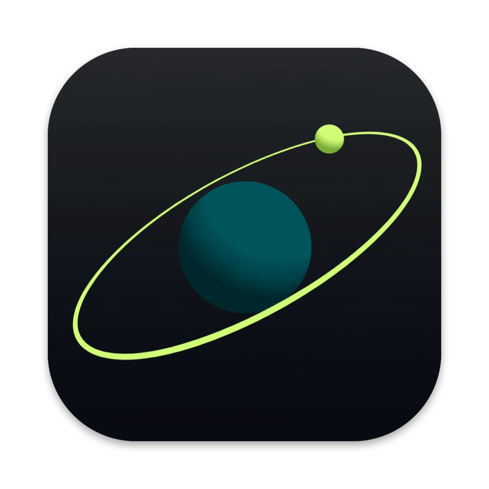
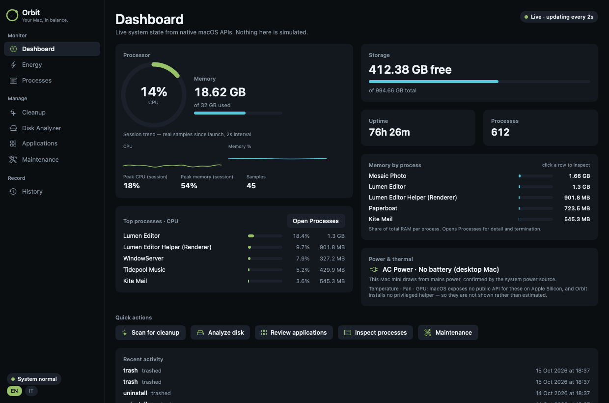
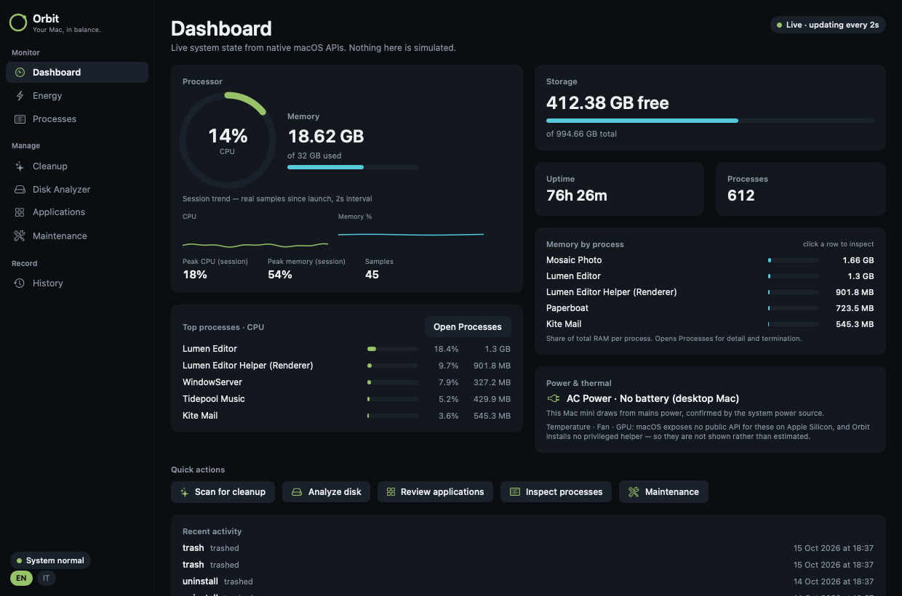
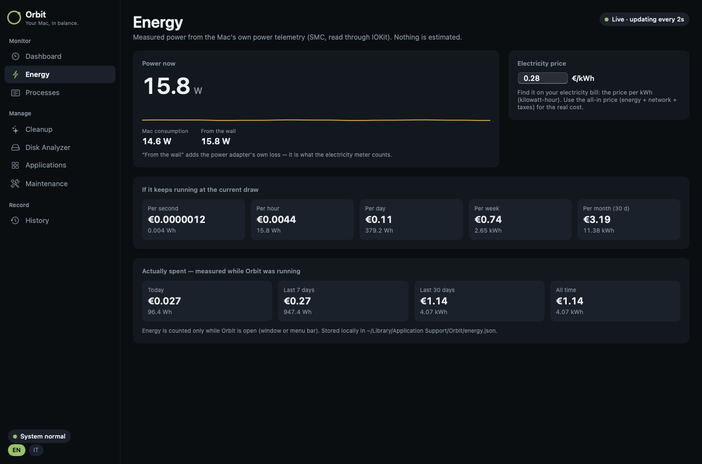
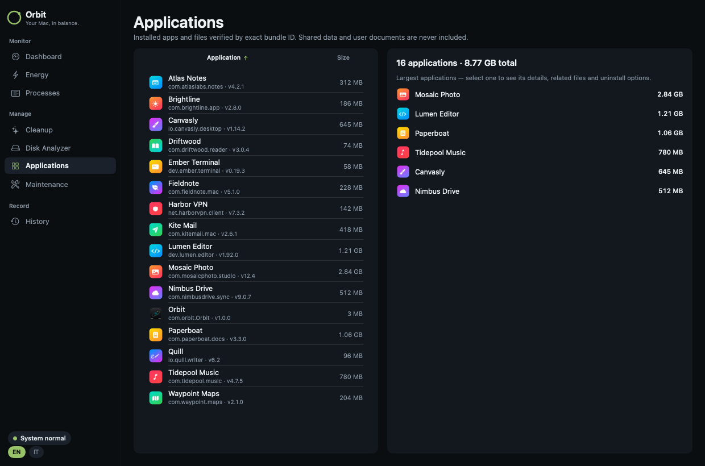
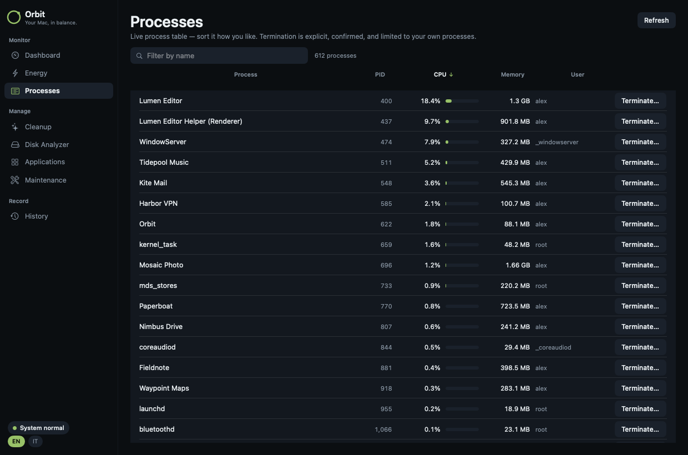
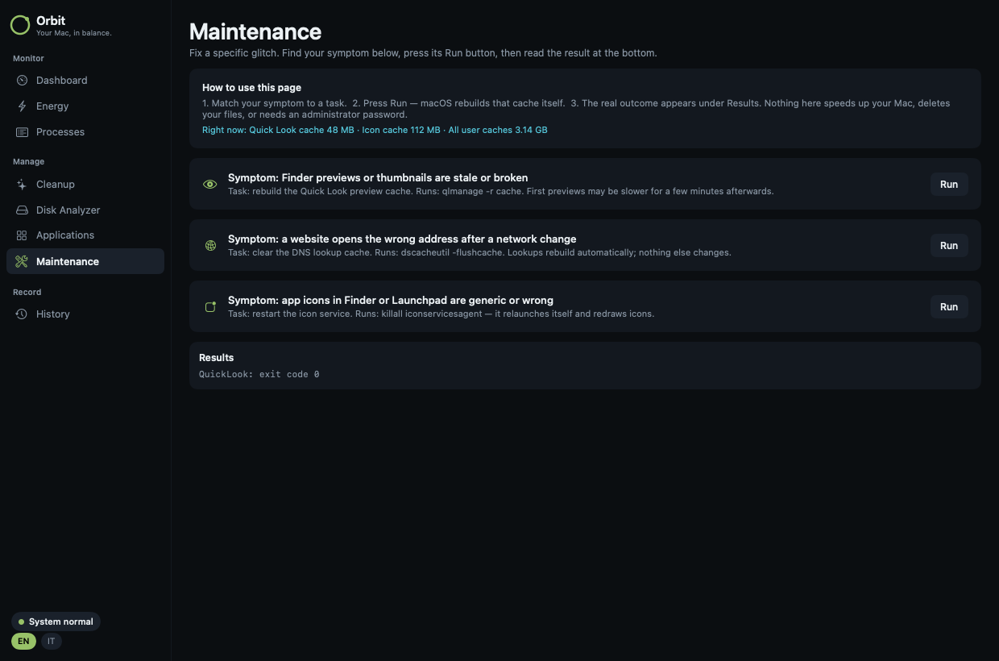

<div align="center">



# Orbit

**Your Mac, in balance.**

A native macOS maintenance app that shows you what your Mac is really doing — and cleans up only what you approve.

[](#install)
[](Package.swift)
[](Package.swift)
[](https://github.com/Sero3105/OrbitA/actions/workflows/ci.yml)
[](LICENSE)

[**⬇︎ Download the latest .dmg**](https://github.com/Sero3105/OrbitA/releases/latest) · [Features](#features) · [Safety](#safety-first) · [Build](#build-from-source)



</div>

---

## Why Orbit

Most "Mac cleaner" apps show scary numbers and delete things for you. Orbit does the opposite:

- 🔍 **Real data only.** Every number comes from native macOS APIs. If macOS doesn't expose something (fan speed, temperature), Orbit says so instead of inventing it.
- 🗑️ **Review first, Trash always.** Scans never touch a file. Anything removed goes to the Trash — recoverable — after you confirm it.
- 🔒 **Private by design.** No network, no telemetry, no account, no `sudo`, no background helper.
- 🪶 **Tiny and native.** SwiftUI, zero dependencies, ~2 MB.
- 🌍 **English & Italiano.** Switch language from the sidebar at any time.

## Features

<table>
<tr>
<td width="50%"></td>
<td width="50%"></td>
</tr>
<tr>
<td><b>Dashboard</b> — live CPU, memory, storage, uptime, process count, top processes by CPU and RAM, power source. Refreshes every 2 seconds.</td>
<td><b>Energy</b> — real-time wattage from the Mac's own power telemetry, your price per kWh, and what your Mac costs per second, hour, day, week and month — plus what it <i>actually</i> spent today, this week and this month.</td>
</tr>
<tr>
<td></td>
<td></td>
</tr>
<tr>
<td><b>Applications</b> — every installed app with version, size and bundle ID. Uninstall removes the app <i>and all its leftovers</i>: preferences, caches, containers, group containers, saved state, cookies, web data, launch agents — matched by exact bundle ID.</td>
<td><b>Processes</b> — live, sortable process table. Terminate your own processes after confirmation (SIGTERM).</td>
</tr>
<tr>
<td></td>
<td>
<b>Maintenance</b> — fix specific glitches by symptom: rebuild Quick Look previews, flush DNS, refresh app icons. Each task shows exactly what it runs and its real result.<br><br>
<b>Cleanup</b> — read-only scan of app caches, old logs, old installers in Downloads, Xcode DerivedData and developer/AI-tool caches. Safe items pre-selected, everything else is opt-in.<br><br>
<b>Disk Analyzer</b> — measure folders, drill down, reveal in Finder. Partial scans are flagged, never presented as complete.<br><br>
<b>History & menu bar</b> — a local log of every change Orbit made, and a menu-bar summary of CPU, memory, disk and power.
</td>
</tr>
</table>

### How the energy numbers work

Apple Silicon Macs — laptops **and** desktops like the Mac mini — publish power telemetry from the SMC through IOKit. Orbit reads it every 2 seconds (public API, no root):

| Value | Meaning |
|---|---|
| **Mac consumption** | Power the Mac itself is using |
| **From the wall** | Consumption + power-adapter loss — what your electricity meter counts |
| **Cost projections** | Current wall power × your €/kWh, over a second, hour, day, week, month |
| **Actually spent** | Energy integrated sample by sample while Orbit runs, stored per day in `~/Library/Application Support/Orbit/energy.json` |

Enter the **all-in price per kWh** from your electricity bill (energy + network + taxes) for the real cost.

## Install

1. Download **`Orbit-x.y.z.dmg`** from [Releases](https://github.com/Sero3105/OrbitA/releases/latest).
2. Open it and drag **Orbit** onto **Applications**.
3. First launch: Orbit is not notarized by Apple yet, so macOS will block it once. Open **System Settings → Privacy & Security**, scroll down and click **Open Anyway**.
   <br><sub>Terminal alternative: `xattr -dr com.apple.quarantine /Applications/Orbit.app`</sub>

Requires **macOS 14 Sonoma or later**.

## Safety first

| Guarantee | How |
|---|---|
| Scans are read-only | Scanners only list and measure; enforced by the check suite |
| Deletion is recoverable | Everything goes to the Trash via `FileManager.trashItem`, never `rm` |
| Nothing deleted without you | Every removal needs an explicit confirmation |
| Paths are revalidated | Right before trashing: same inode, inside an allowed root, not a symlink, not a protected system path |
| No privilege escalation | No `sudo`, no privileged helper, no SIP/TCC bypass |
| No shell injection | Fixed executables with fixed arguments; nothing from the UI reaches a shell |
| No network | Orbit makes no network requests at all |

Details: [docs/security-model.md](docs/security-model.md) · [docs/cleanup-safety.md](docs/cleanup-safety.md) · [SECURITY.md](SECURITY.md)

## Build from source

Only the Swift toolchain is needed — Command Line Tools are enough, Xcode is optional.

```bash
git clone https://github.com/Sero3105/OrbitA.git && cd OrbitA
swift run Orbit                   # run in development
swift run OrbitCheck              # run the check suite
./scripts/package.sh              # build, check, sign ad hoc, install to /Applications
INSTALL=0 ./scripts/package.sh    # build only → build/Orbit.app
VERSION=1.1.0 ./scripts/release.sh   # → build/Orbit-1.1.0.dmg + .sha256
```

### Releasing

Push a version tag and GitHub Actions builds a universal (Apple Silicon + Intel) DMG and publishes the release:

```bash
git tag v1.1.0 && git push origin v1.1.0
```

To ship a notarized DMG (no Gatekeeper warning), run `release.sh` with `SIGN_ID="Developer ID Application: …"` and `NOTARY_PROFILE=…` — see the header of [scripts/release.sh](scripts/release.sh).

### Tests

`swift run OrbitCheck` runs the self-contained check suite (XCTest isn't available with Command Line Tools alone). It uses temporary fixtures only and covers: read-only scanning, symlink / protected-path / stale-inode rejection, dry-run execution, disk scanning, uninstall leftover matching, power telemetry mapping, the energy ledger and cost math. `swift run OrbitCheck bench` prints timings. CI runs it on every push.

## Project layout

```
Sources/
  OrbitCore/    scanning, safety validation, metrics, power telemetry (no UI)
  Orbit/        SwiftUI app: views, theme, localization
  OrbitCheck/   check suite + benchmarks
scripts/        package.sh, release.sh
docs/           architecture, security model, audits
```

## Limitations

- No fan speed, temperature or GPU stats — macOS has no public API for them without a privileged helper.
- Energy is counted only while Orbit is running.
- No app-update checks — there's no reliable source, so Orbit doesn't pretend.
- Not yet notarized (see [Install](#install)).

## Contributing

Issues and pull requests are welcome. Please run `swift run OrbitCheck` before opening a PR, and keep the safety guarantees above intact. Security issues: see [SECURITY.md](SECURITY.md).

## License

[MIT](LICENSE). Orbit's feature set was inspired by [Mole](https://github.com/tw93/Mole); it is an independent clean-room implementation and contains no Mole code or assets.
